# Test results

Generated by `pytest tests --results-page docs/test-results.md` (in CI on every push to `main`).
Do not edit by hand.

Each sheet metal test part is a STEP file with its flat pattern worked out by hand
(`<name>.json` beside it). flatmat unfolds the part at the K the JSON gives and is compared
with that flat: flat area (relative tolerance 1e-09), flat size (1e-06 mm) and the
number of holes. The tests that name a part check more: thickness, bends, each bend's
allowance θ·(R + K·t), hole positions, features, other K-factors and, where it holds,
flat area × t = volume at K 0.5.

Where the expected values come from (the **Source** column):

- **SolidCraft (analytic)**: a part of SolidCraft's reference tests
  ([`tests/oracle/`](https://github.com/tangency-labs/solidcraft/tree/main/tests/oracle)),
  rebuilt here. Its folded volume and area match SolidCraft's hand-worked values to 1e-9, so it
  is the same part; its flat is worked out by hand here (SolidCraft checks only the folded part).
- **by hand**: closed-form geometry, the formula in the **Method** column (BA = θ·(R + K·t)).

No expected value comes from a commercial CAD product. The pictures show each part in 3D and
flatmat's flat pattern (bend lines: up red, down blue, joggle orange); they are drawn by
`python tests/render_parts.py`, not by the test run.

**32 / 32 parts pass**; sources: 9 solidcraft reference parts, 23 hand-worked parts. All tests: 723 passed, 0 failed, 2 skipped.

Run 2026-11-23 16:22 UTC, commit `350061a53e`, Python 3.13.18, OCP 8.0.1.1, Linux x86_64.

## SolidCraft reference parts

Files: [`tests/data/solidcraft_oracle`](../tests/data/solidcraft_oracle/README.md); tests: `tests/test_oracle.py`.

| Part | Result | Source | Flat (flatmat) | Error vs hand | Tests | Method: flat by hand | What it is |
|---|---|---|---|---|---:|---|---|
| 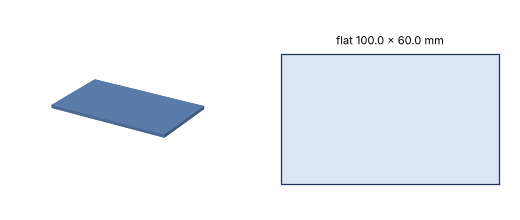 `sc67_base_flange` | ✅ pass | [SolidCraft 67](https://github.com/tangency-labs/solidcraft/tree/main/tests/oracle/67-sm-base-flange) (analytic); flat by hand | 60.000 × 100.000 mm area 6000.000 mm² t 2.5, K 0.44, 0 bends, 0 holes | area 0.0e+00 size 0.0e+00 mm | 7 / 7 | 100 × 60 | plate 100 × 60 × 2.5, no bend |
| 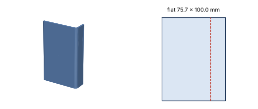 `sc68_edge_flange` | ✅ pass | [SolidCraft 68](https://github.com/tangency-labs/solidcraft/tree/main/tests/oracle/68-sm-edge-flange) (analytic); flat by hand | 75.655 × 100.000 mm area 7565.487 mm² t 2.5, K 0.44, 1 bend, 0 holes | area 4.9e-15 size 3.7e-13 mm | 7 / 7 | 100 × (55 + BA + 15) | one 90° flange, R 2.5, t 2.5 |
| 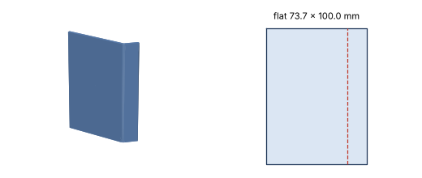 `sc70_flange_45` | ✅ pass | [SolidCraft 70](https://github.com/tangency-labs/solidcraft/tree/main/tests/oracle/70-sm-flange-45) (analytic); flat by hand | 73.685 × 100.000 mm area 7368.530 mm² t 2.5, K 0.44, 1 bend, 0 holes | area 1.4e-14 size 1.1e-12 mm | 7 / 7 | 100 × (57.929 + BA + 12.929), setback (R + t)·tan 22.5° = 2.071 | one 45° flange |
| 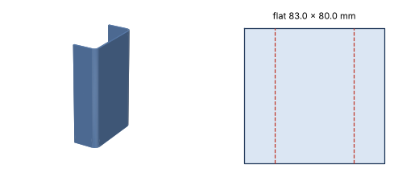 `sc71_custom_rule` | ✅ pass | [SolidCraft 71](https://github.com/tangency-labs/solidcraft/tree/main/tests/oracle/71-sm-custom-rule) (analytic); flat by hand | 80.000 × 82.980 mm area 6638.389 mm² t 1.5, K 0.33, 2 bends, 0 holes | area 8.6e-15 size 7.1e-13 mm | 7 / 7 | 80 × (15.5 + 41 + 15.5 + 2 BA) | U channel, t 1.5, R 3, K 0.33 |
| 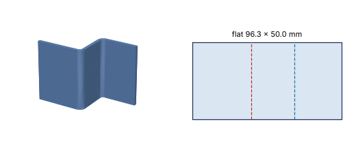 `sc72_contour_flange` | ✅ pass | [SolidCraft 72](https://github.com/tangency-labs/solidcraft/tree/main/tests/oracle/72-sm-contour-flange) (analytic); flat by hand | 50.000 × 96.310 mm area 4815.487 mm² t 2.5, K 0.44, 2 bends, 0 holes | area 7.7e-15 size 7.4e-13 mm | 7 / 7 | 50 × (35 + 22.5 + 27.5 + 2 BA) | Z profile, two bends turning opposite ways |
| 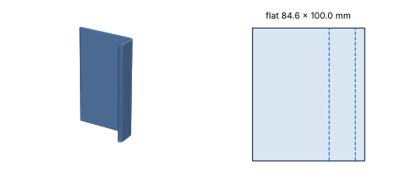 `sc73_hem` | ✅ pass | [SolidCraft 73](https://github.com/tangency-labs/solidcraft/tree/main/tests/oracle/73-sm-hem) (analytic); flat by hand | 84.621 × 100.000 mm area 8462.133 mm² t 2.5, K 0.44, 2 bends, 0 holes | area 7.1e-15 size 6.0e-13 mm | 7 / 7 | 100 × (55 + 15 + 5.495 + BA₉₀ + BA_hem), BA_hem = π·(0.005 + K·t) | flange with a flat hem: 180°, inner radius 0.005, leg 0.01 mm from the flange |
| 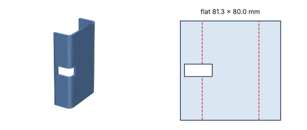 `sc74_unfold_refold` | ✅ pass | [SolidCraft 74](https://github.com/tangency-labs/solidcraft/tree/main/tests/oracle/74-sm-unfold-refold) (analytic); flat by hand | 80.000 × 81.310 mm area 6284.779 mm² t 2.5, K 0.44, 2 bends, 1 hole | area 9.3e-15 size 7.4e-13 mm | 7 / 7 | 80 × (40 + 2·15 + 2 BA) − 10 × (5 + BA + 11.345); the slot is 22 long at K 0.44 | U channel with a 10 × 22 slot cut across a bend in the flat |
| 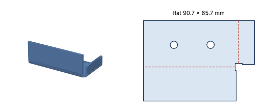 `sc75_bracket_holes` | ✅ pass | [SolidCraft 75](https://github.com/tangency-labs/solidcraft/tree/main/tests/oracle/75-sm-bracket-holes) (analytic); flat by hand | 65.655 × 90.655 mm area 5441.115 mm² t 2.5, K 0.44, 2 bends, 2 holes | area 5.2e-15 size 3.7e-13 mm | 7 / 7 | 75 × 35 − 2·π·3² + BA·(75 + 35) + 25 × 75.732 + 10 × 35.732 | two flanges meeting at a mitred corner, two Ø6 holes |
|  `sc76_thickness_variant` | ✅ pass | [SolidCraft 76](https://github.com/tangency-labs/solidcraft/tree/main/tests/oracle/76-sm-thickness-variant) (analytic); flat by hand | 74.786 × 100.000 mm area 7478.584 mm² t 3, K 0.44, 1 bend, 0 holes | area 5.8e-15 size 4.4e-13 mm | 7 / 7 | 100 × (54 + BA + 14) | one flange, t 3, R 3 |

## Hand-worked parts: holes across bends, boxes, hems, joggles, countersinks

Files: [`tests/data/handworked`](../tests/data/handworked/README.md); tests: `tests/test_handworked.py`.

| Part | Result | Source | Flat (flatmat) | Error vs hand | Tests | Method: flat by hand | What it is |
|---|---|---|---|---|---:|---|---|
| 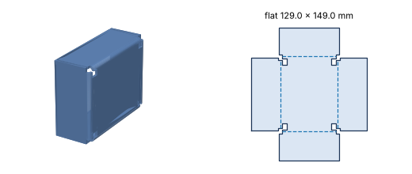 `box_closed` | ✅ pass | by hand | 129.048 × 149.048 mm area 14890.499 mm² t 2, K 0.44, 4 bends, 0 holes | area 2.9e-15 size 6.3e-13 mm | 6 / 6 | as `box_relief`, plus 8 wall tabs: 4·H·(R + t) + 4·H·(R + g − 1) | `box_relief` with tabs closing the corners to 1 mm |
| 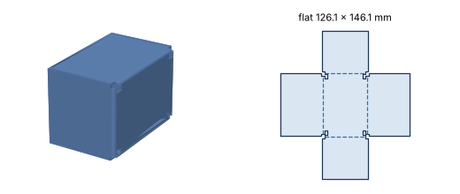 `box_deep_closed` | ✅ pass | by hand | 126.095 × 146.095 mm area 11497.185 mm² t 1, K 0.44, 4 bends, 0 holes | area 1.7e-15 size 4.0e-13 mm | 6 / 6 | L·W + 2(BA + H)·(W + L − 2g) − 4·3·(g + 3) + 4·H·(R + t) + 4·H·(R + g − 0.5) | box 60 × 40 × 40, t 1, R 1.5, closed corners 0.5 apart, reliefs 3 |
| 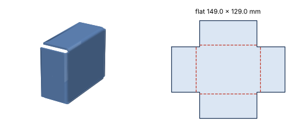 `box_open` | ✅ pass | by hand | 129.048 × 149.048 mm area 14190.499 mm² t 2, K 0.44, 4 bends, 0 holes | area 4.7e-15 size 6.0e-13 mm | 6 / 6 | L·W + 2(BA + H)·W + 2(BA + H)·(L − 2g): base, 4 bends, 4 walls (L 80, W 60, H 30, gap g 2) | box 80 × 60 × 30, t 2, R 2: short walls stop 2 short of the long walls' bends |
| 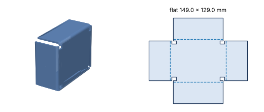 `box_relief` | ✅ pass | by hand | 129.048 × 149.048 mm area 14050.499 mm² t 2, K 0.44, 4 bends, 0 holes | area 4.1e-15 size 6.0e-13 mm | 6 / 6 | as `box_open`, less 4 reliefs 5 × (g + 5) | `box_open` with 5 × 5 corner reliefs in the base |
| 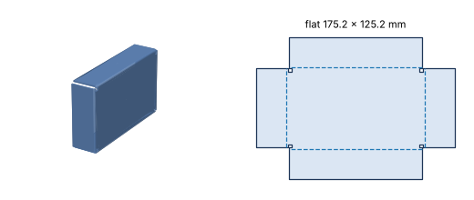 `box_thin` | ✅ pass | by hand | 125.215 × 175.215 mm area 18732.428 mm² t 1.5, K 0.44, 4 bends, 0 holes | area 2.7e-15 size 3.7e-13 mm | 6 / 6 | L·W + 2(BA + H)·(W + L − 2g) − 4 reliefs 3 × (g + 3) | box 120 × 70 × 25, t 1.5, R 1, gap 1, reliefs 3 |
| 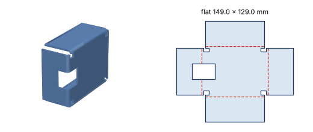 `box_window` | ✅ pass | by hand | 129.048 × 149.048 mm area 13460.021 mm² t 2, K 0.44, 4 bends, 1 hole | area 3.9e-15 size 6.0e-13 mm | 6 / 6 | as `box_relief`, less 20 × (10 + BA + 15) | `box_relief` with a 20 wide window across a long bend, 10 into the wall, 15 into the base |
| 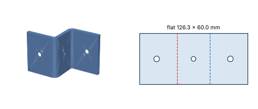 `cbore_Z` | ✅ pass | by hand | 60.000 × 126.336 mm area 7487.995 mm² t 5, K 0.44, 2 bends, 3 holes | area 8.6e-15 size 1.1e-12 mm | 9 / 9 | 60 × (40 + 30 + 40 + 2 BA) − 2·π·6.6²/4 − π·5.5²/4; depth reported | Z, t 5: counterbores Ø6.6 / Ø11, 3 deep, on the outer flats on opposite sides; a countersink in the web |
| 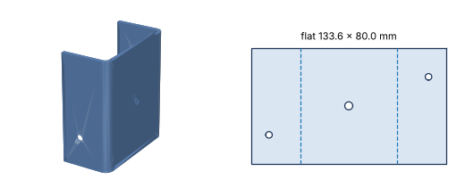 `csk_U` | ✅ pass | by hand | 80.000 × 133.572 mm area 10630.168 mm² t 3, K 0.44, 2 bends, 3 holes | area 6.8e-15 size 9.1e-13 mm | 9 / 9 | W × (flats + 2 BA) − Σ π·d²/4 (through holes); centres at s = flats + BA + f·flat | U channel, t 3: 90° countersinks on the base and both flanges, both sides |
| 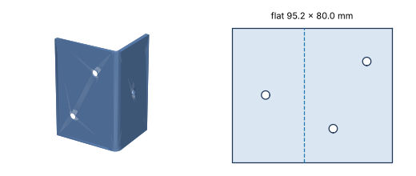 `csk_angles` | ✅ pass | by hand | 80.000 × 95.215 mm area 7558.299 mm² t 3, K 0.44, 1 bend, 3 holes | area 3.6e-15 size 3.6e-13 mm | 9 / 9 | 80 × (50 + BA + 40) − 3·π·5²/4; centres as `csk_U`, each angle reported | L, t 3: 82°, 100° and 120° countersinks |
| 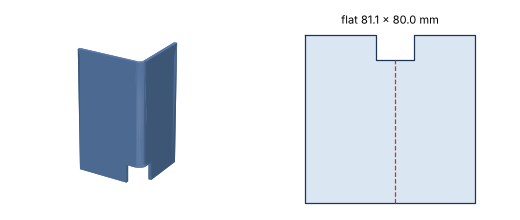 `hb_notch` | ✅ pass | by hand | 80.000 × 81.095 mm area 6270.439 mm² t 2, K 0.44, 1 bend, 0 holes | area 4.2e-15 size 4.0e-13 mm | 6 / 6 | outline less 12 × (6 + BA + 6) | the same L, a 12 deep notch cut in from the edge across the bend |
|  `hb_radial` | ✅ pass | by hand | 60.000 × 84.640 mm area 4981.591 mm² t 3, K 0.44, 1 bend, 1 hole | area 8.4e-12 size 9.7e-13 mm | 5 / 5 | 4·rn·r_s·(E(m) − (1 − m)·K(m)), m = (a/r_s)²; depends on the skin developed (both given) | L, t 3, R 8: a Ø10 hole drilled radially through the middle of the bend |
| 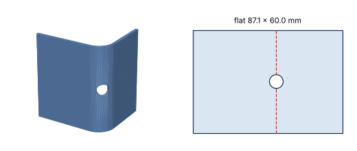 `hb_refold_mid` | ✅ pass | by hand | 60.000 × 87.090 mm area 5175.150 mm² t 2, K 0.44, 1 bend, 1 hole | area 2.5e-12 size 1.1e-12 mm | 7 / 7 | the Ø8 circle at K 0.44; π·4²·(R + K·t)/(R + 0.44·t) at another K | L, t 2, R 10: a Ø8 hole cut in the flat at mid-bend, folded at K 0.44 (radial wall) |
| 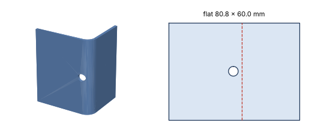 `hb_refold_tangent` | ✅ pass | by hand | 60.000 × 80.807 mm area 4820.150 mm² t 2, K 0.44, 1 bend, 1 hole | area 1.4e-12 size 7.2e-13 mm | 7 / 7 | the Ø6 circle at K 0.44: half arc, half spline | L, t 2, R 6: a Ø6 hole cut in the flat on the bend's tangent line, folded at K 0.44 |
| 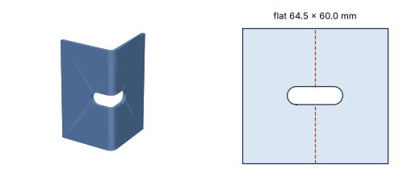 `hb_slot` | ✅ pass | by hand | 60.000 × 64.524 mm area 3688.977 mm² t 2, K 0.44, 1 bend, 1 hole | area 4.1e-15 size 3.0e-13 mm | 6 / 6 | 8 × (12 + BA) + π·4² | L, t 2, R 2: an 8 wide slot across the bend, round ends 6 into each flange |
| 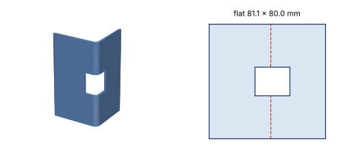 `hb_window` | ✅ pass | by hand | 80.000 × 81.095 mm area 6005.681 mm² t 2, K 0.44, 1 bend, 1 hole | area 3.9e-15 size 4.0e-13 mm | 6 / 6 | hole 20 × (8 + BA + 10) | L, t 2, R 3: a 20 wide window across the bend, 8 into one flange, 10 into the other |
| 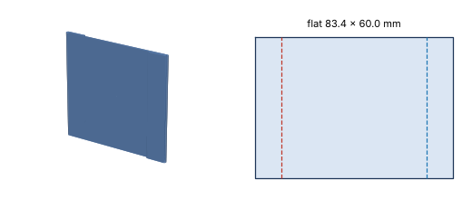 `hem_closed_both` | ✅ pass | by hand | 60.000 × 83.393 mm area 5003.575 mm² t 1, K 0.44, 2 bends, 0 holes | area 2.5e-15 size 2.1e-13 mm | 7 / 7 | width × (flats + 2 BA_hem) | plate, t 1, closed hems (R 0.1, 0.2 mm gap) at both ends on opposite sides |
| 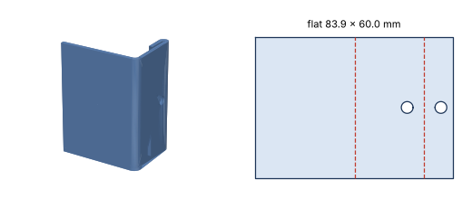 `hem_hole_through_both` | ✅ pass | by hand | 60.000 × 83.859 mm area 4992.288 mm² t 2, K 0.44, 2 bends, 2 holes | area 7.1e-15 size 6.0e-13 mm | 10 / 10 | two Ø5 holes BA_hem + 10 apart | L with a hem (R 0.5); a Ø5 hole drilled through the hem leg and the flange behind it |
| 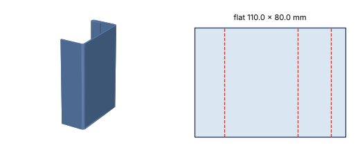 `hem_open_U` | ✅ pass | by hand | 80.000 × 110.001 mm area 8800.071 mm² t 1.5, K 0.44, 3 bends, 0 holes | area 7.0e-15 size 7.8e-13 mm | 7 / 7 | width × (flats + 2 BA + BA_hem) | U channel, t 1.5, an open hem (R 1, 2 mm gap) folded into the channel |
| 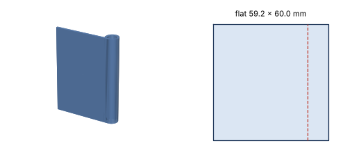 `hem_rolled_270` | ✅ pass | by hand | 59.247 × 60.000 mm area 3554.841 mm² t 1.5, K 0.44, 1 bend, 0 holes | area 1.9e-14 size 1.1e-12 mm | 7 / 7 | width × (40 + 2 + BA_270) | a rolled edge: one 270° bend, R 3, a 2 mm leg |
| 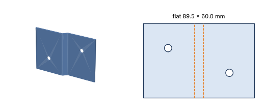 `joggle_offset` | ✅ pass | by hand | 60.000 × 89.524 mm area 5314.885 mm² t 2, K 0.44, 2 bends, 2 holes | area 2.5e-14 size 2.2e-12 mm | 12 / 12 | holes 20 + BA + 5 + BA + 20 apart along, 20 across | 45° joggle, 5 mm between its bends, a Ø6 hole either side |
| 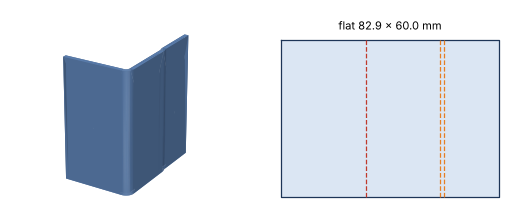 `joggle_on_flange` | ✅ pass | by hand | 60.000 × 82.931 mm area 4975.847 mm² t 2, K 0.44, 3 bends, 0 holes | area 1.9e-14 size 1.6e-12 mm | 9 / 9 | width × (flats + 3 BA) | L whose flange is joggled: two tangent 20° bends, R 4, no flat between |
| 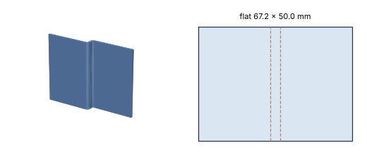 `joggle_z_tight` | ✅ pass | by hand | 50.000 × 67.215 mm area 3360.752 mm² t 1.5, K 0.44, 2 bends, 0 holes | area 5.3e-15 size 3.6e-13 mm | 9 / 9 | width × (flats + 2 BA) | Z joggle: two 90° bends, R 1, 2 mm apart, t 1.5 |
| 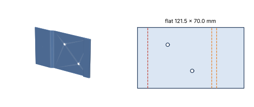 `panel_hem_joggle_csk` | ✅ pass | by hand | 70.000 × 121.477 mm area 8478.257 mm² t 1.5, K 0.44, 3 bends, 2 holes | area 7.3e-14 size 8.8e-12 mm | 10 / 10 | 70 × (10 + 70 + 4 + 30 + BA_hem + 2 BA₃₀) − 2·π·4²/4 | t 1.5: a hem at one end, a joggle at the other, two countersinks between |

## Test files

| File | Passed | Failed | Skipped |
|---|---:|---:|---:|
| `test_bendmodel.py` | 14 | 0 | 0 |
| `test_canonical.py` | 43 | 0 | 0 |
| `test_cli.py` | 3 | 0 | 0 |
| `test_corners.py` | 6 | 0 | 0 |
| `test_cut_forms.py` | 18 | 0 | 0 |
| `test_dfm.py` | 31 | 0 | 0 |
| `test_engrave.py` | 31 | 0 | 0 |
| `test_export.py` | 7 | 0 | 0 |
| `test_external.py` | 24 | 0 | 2 |
| `test_features.py` | 5 | 0 | 0 |
| `test_fold.py` | 20 | 0 | 0 |
| `test_formed.py` | 9 | 0 | 0 |
| `test_generated.py` | 38 | 0 | 0 |
| `test_geom2d.py` | 3 | 0 | 0 |
| `test_handworked.py` | 163 | 0 | 0 |
| `test_io_xcaf.py` | 24 | 0 | 0 |
| `test_joggle.py` | 27 | 0 | 0 |
| `test_kinds.py` | 2 | 0 | 0 |
| `test_oracle.py` | 63 | 0 | 0 |
| `test_pmi_map.py` | 90 | 0 | 0 |
| `test_pmi_read.py` | 51 | 0 | 0 |
| `test_property.py` | 1 | 0 | 0 |
| `test_refusals.py` | 5 | 0 | 0 |
| `test_sequence.py` | 8 | 0 | 0 |
| `test_sharp.py` | 19 | 0 | 0 |
| `test_spline.py` | 8 | 0 | 0 |
| `test_tooling.py` | 10 | 0 | 0 |
